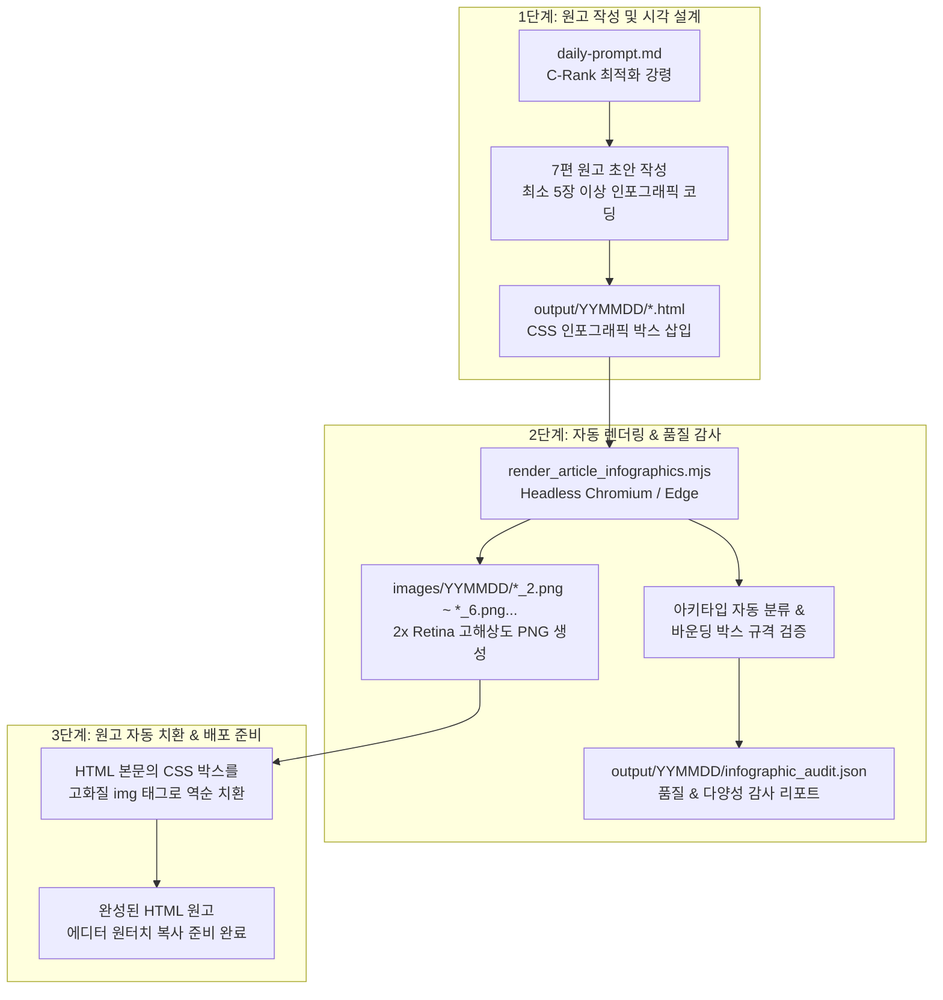

# 네이버 블로그 지속 진화형 인포그래픽 디자인 시스템
**Continuous Infographic Evolution & Visual Design System (v2.0)**

> 📌 **핵심 원칙**: 
> 1. **과금 0원 & C-Rank 최적화 (1 Hero JPG + 최소 5개 이상 PNG, 상한선 없음)**: 1번 대표 썸네일(AI 이미지)만 Antigravity IDE 무료 쿼터로 생성하고, 2번 이후의 모든 인포그래픽 카드(**최소 5장 이상, 글당 총 6장 이상**)는 브라우저 엔진이 자동 2x Retina PNG로 렌더링하여 네이버 C-Rank 미디어 풍부도와 체류시간을 극대화하며, 스마트에디터 레이아웃 깨짐을 100% 영구 방지한다.
> 2. **지속 진화 & 천편일률성 타파**: 고정된 템플릿의 기계적 반복을 금지하며, 글의 성격과 깊이에 맞춰 10대 공식 아키타입과 범용 프리미티브를 자율 조합·창작하여 매일 진화하는 비주얼을 제공한다.
> 3. **네이버 AI 브리핑 인용 극대화 (누적 175만·월 43만 달성 규격)**: AI 파서가 즉시 정량 데이터로 인용할 수 있는 고순도 비교표, 영수증, 절차도, 수치 매트릭스를 완벽히 시각화한다.

---

## 1. 시스템 아키텍처 파이프라인

---

## 2. 10대 공식 아키타입 카탈로그

각 원고는 다루는 주제의 핵심 질문과 독자의 정보 탐색 의도에 맞춰 아래 아키타입 중 **최소 5개 이상(5~7장)**을 최적 조합합니다.

| 번호 | 아키타입 | CSS 클래스 | 핵심 용도 및 전달 가치 | 최적 추천 카테고리 |
|:---:|:---|:---|:---|:---|
| **1** | **비교 매트릭스** | `.infographic-compare-box` | 복수 코스·옵션·제도 간 스펙, 난이도, 장단점 격자 대조 | ⛳ 골프코스 비교, 🚗 제도 비교, 🛠️ 셀프 vs 업체 |
| **2** | **타임라인/동선** | `.infographic-timeline-box` | 오전/오후 시간대별 최적 이동 동선, 체류시간 및 주의구간 | 🏞️ 여행 코스, ⛳ 18홀 라운딩 일정, 🚗 축제 우회로 |
| **3** | **코스/전술 공략도** | `.infographic-strategy-box` | 킬러 홀, 위험 해저드/벙커 회피법, 등산 난코스 공략 팁 | ⛳ 해외골프 명문홀, 🏞️ 가을 단풍 험로, 🛠️ 수리 취약부 |
| **4** | **실전 비용 영수증** | `.infographic-receipt-box` | 그린피·카트·캐디피·팁·부품비·환급금 등 상세 정산표 | ⛳ 골프 1인 총예산, 🚗 채권 환급액, 🛠️ 셀프 자재비 |
| **5** | **점검 체크리스트** | `.infographic-checklist-box` | 출국 준비물, 필수 점검 사항, 신청 요건 3열 체크리스트 | ⛳ 해외골프 준비물, 🏞️ 여행 포토존, 🏡 동파 방지 점검 |
| **6** | **절차 플로우차트** | `.infographic-flow-box` | 신청 4단계, 셀프 시공 4단계, 분쟁 대응 4단계 순서도 | 🛠️ 수리/DIY 절차, 🚗 온라인 환급 절차, 🧪 노무 신청 |
| **7** | **4분할 수치 매트릭스**| `.infographic-stat-box` | 입장료, 주차, 소요시간, 적정기온 등 4대 핵심 지표 요약 | 🏞️ 국내여행 핵심스펙, 🔥 이슈 행사 개요, 🏡 난방 지표 |
| **8** | **평가지표 스코어카드**| `.infographic-scorecard-box` | 전장, 잔디관리, 난이도, 가성비 게이지 바 및 평점 칩 | ⛳ 골프장 종합 평가, 🛠️ 작업 난이도 지표, 🏞️ 단풍 지수 |
| **9** | **장단점 대조표** | `.infographic-procon-box` | 추천 대상 vs 비추천 대상, 강력 추천 요소 vs 주의점 대조 | ⛳ 코스별 호불호, 🛠️ 자재별 장단점, 🚗 차종별 환급 |
| **10**| **핵심 Q&A 매트릭스** | `.infographic-faq-box` | 검색자가 가장 자주 묻는 핵심 질문 TOP 3와 직답 | 🚗 환급 시효 질문, 🏡 누수 보상 질문, ⛳ 캐디팁 규정 |

---

## 3. 진화형 범용 프리미티브 (Design Primitives)

기존 10대 카탈로그 외에 **글의 독창적 맥락에 맞는 새로운 시각화**가 필요할 때는 다음의 범용 프리미티브를 조합하여 자유롭게 신규 인포그래픽 카드를 합성할 수 있습니다.

- **컨테이너 규칙**: 최상위 태그는 반드시 `
` 또는 `div[class*='infographic-']` 구조를 사용합니다.
- **주요 프리미티브 요소**:
  - `.info-callout`: 왼쪽 악센트 테두리가 들어간 핵심 주의/강조 콜아웃 블록
  - `.info-pill-list` & `.info-pill`: 키워드 태그, 추천 대상군 뱃지 나열
  - `.score-bar-bg` & `.score-bar-fill`: 0~100% 수치 게이지 바
  - `.hazard-tag` & `.safe-tag`: 위험 경고(빨강) 및 안전 권장(초록) 마이크로 칩

---

## 4. 지속 진화형 인포그래픽 4대 강령 (Evolution Directives)

### 강령 1. 동일 날짜 원고 간 카드 복제 엄금 (Anti-Monotony Guard)
- 하루 7편의 원고가 동일한 카드 조합(예: 7편 모두 비교+체크리스트)을 기계적으로 베끼는 것을 엄격히 금지합니다.
- 카테고리별로 고유한 비주얼 페르소나를 부여하며, 각 원고당 최소 5개 이상의 카드를 배치합니다:
  - ⛳ **해외골프**: 코스비교 + 전술공략도 + 1인 영수증 + 스코어카드 + 라운딩 체크리스트
  - 🏞️ **국내여행**: 타임라인 로드맵 + 4분할 수치 매트릭스 + 포토존 체크리스트 + 추천 대조표 + 핵심 Q&A
  - 🛠️ **생활수리/주택**: 단계별 플로우 + 자재비 영수증 + 셀프 vs 업체 비교 + 점검 체크리스트 + 핵심 Q&A
  - 🚗 **자동차/실무**: 온라인 신청 플로우 + 환급/비용 영수증 + 유형별 비교 매트릭스 + 구비서류 체크리스트 + 핵심 Q&A

### 강령 2. 내용 적합성 기반 대량 배치 (Semantic Density — 최소 5장 이상 체제)
- 원고의 주제와 핵심 팩트의 깊이에 따라 카드를 **최소 5장 이상(글당 총 6장 이상, 상한선 없음)** 적극적으로 분산 배치합니다.
- 소제목 1~2개마다 맞춤형 시각 카드를 배치하여 텍스트 피로도를 없애고 독자 체류시간(Dwell Time)을 극대화합니다.

### 강령 3. 창의적 비주얼 신규 합성 장려 (Generative Visual Synthesis)
- 카탈로그에 없는 형태라도 독자의 이해를 돕는 시각화(예: 배점표, 위험 분기점, 단계별 체크포인트, 모의 견적서 등)가 필요하면 범용 프리미티브 클래스를 조합해 새로운 레이아웃을 능동적으로 창작합니다.

### 강령 4. 네이버 AI 브리핑 인용 극대화
- 인포그래픽 카드는 단순한 장식이 아니라, 네이버 AI 브리핑 검색엔진이 '표/수치/정량 팩트'로 인식하여 본문 링크와 함께 상단에 최우선 노출할 수 있는 핵심 정형 데이터를 담아야 합니다.

---

## 5. 자동 품질 검증 & 다양성 감사 엔진

`render_article_infographics.mjs`가 원고를 렌더링할 때 다음 품질 및 다양성 검사를 자동으로 수행합니다.

1. **해상도 및 가독성 최적화**:
   - 뷰포트 너비 1,000px, `deviceScaleFactor: 2` (2x Retina)로 캡처하여 모바일 및 PC 네이버 뷰어에서 극상의 선명도 유지.
   - `-apple-system, Malgun Gothic, Noto Sans KR` 안티앨리어싱 자동 강제.
2. **바운딩 박스 무결성 검증**:
   - 카드의 너비(`width >= 500px`), 높이(`height >= 100px`), 종횡비를 측정하여 레이아웃 깨짐이나 텍스트 잘림 현상 방지.
3. **일일 다양성 지표 산출**:
   - 매일 배치 작업 완료 후 `output/YYMMDD/infographic_audit.json`을 자동 생성하여 어떤 아키타입이 몇 개 쓰였는지 다양성 지수를 기록합니다.

---

## 6. 사용자 작업 플로우 (100% 무료 쿼터)

1. **새벽 4시 일일 자동 실행 (`daily-run.ps1`)**:
   - 원고 7편 작성 ➔ 인포그래픽 카드 자동 탐지 ➔ 2x Retina PNG 렌더링 ➔ HTML 본문 자동 치환 (`_2.png`, `_3.png`...).
2. **사용자 수동 작업 (1일 1회, 약 2분 소요)**:
   - `prompt_helper.html` 열기.
   - 1번 대표 썸네일 프롬프트 7개를 Antigravity IDE에 복사하여 무료 생성 (과금 0원).
3. **네이버 블로그 발행**:
   - HTML 원고 내용을 스마트에디터에 복사-붙여넣기 시, 2번 이후의 복잡한 표와 다이어그램이 이미 완벽한 고해상도 PNG 이미지로 치환되어 있으므로 **에디터 서식 깨짐이 0%로 완벽 방어**됩니다.
